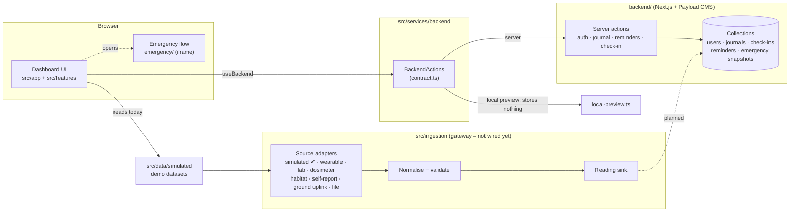

# HEALium – Astronaut Health Monitoring

HEALium is a prototype for monitoring crew health on long-duration space missions,
built for the NASA Space Apps Challenge 2026. It has two parts:

- **Health dashboard** – daily overview, physical health, lab data, environment,
  trends, private journal, daily check-in and a breathing exercise.
- **Emergency flow** – a guided, full-screen assistant for medical emergencies
  (opened with the **Help** button of the dashboard).

> **Prototype – not a medical device.** All health values shown are simulated demo
> data. See [What is real and what is simulated](#what-is-real-and-what-is-simulated).

## Quick start

Requires Node.js 22.12 or newer.

```bash
npm install
npm run dev        # dashboard at http://127.0.0.1:5173/
```

| Command             | Purpose                                              |
| ------------------- | ---------------------------------------------------- |
| `npm run dev`       | Start the local preview with hot reload              |
| `npm run build`     | Build the static site into `dist/`                   |
| `npm run preview`   | Serve the built site                                 |
| `npm run typecheck` | Type-check all TypeScript sources                    |
| `npm test`          | Run the unit tests of the data-ingestion gateway     |

## Repository layout

```
.
├── index.html              Entry page of the dashboard (loads src/main.tsx)
├── src/                    Dashboard (React + TypeScript)
│   ├── main.tsx            Browser entry point of the local preview
│   ├── app/                App shell: layout, navigation, global state
│   ├── features/           One folder per feature / page
│   ├── shared/             UI building blocks and types used by several features
│   ├── data/simulated/     Demo datasets (clearly marked as simulated)
│   ├── services/backend/   Contract between UI and backend + local-preview implementation
│   ├── ingestion/          Data-ingestion gateway: connection points for data sources
│   └── styles/             Stylesheets, one file per concern
├── emergency/              Emergency flow prototype (static HTML/CSS/JS, Three.js)
├── backend/                Server: Payload CMS data model, auth, server actions (Next.js host)
└── docs/                   Documentation
```

| Folder in `src/features/` | Page / function                                         |
| ------------------------- | ------------------------------------------------------- |
| `dashboard/`              | Home dashboard: reminders, summary, widgets, task readiness |
| `physical-health/`        | Physical health categories, radiation exposure chart    |
| `lab-data/`               | Blood and urine test results                            |
| `environment/`            | Cabin / habitat environment                             |
| `trends/`                 | Trends against the personal baseline                    |
| `data-sources/`           | Transparency page about data origins                    |
| `emergency-data/`         | Archive of emergency snapshots                          |
| `customize/`              | Dashboard settings (widget selection and order)         |
| `breathing/`              | Guided breathing exercise                               |
| `check-in/`               | Daily health check-in (morning / evening)               |
| `journal/`                | Private journal                                         |
| `auth/`                   | Sign-in and registration dialog                         |

## Architecture at a glance



- The **UI never talks to a concrete backend**. It calls the functions of the
  `BackendActions` contract. The local preview plugs in an implementation that stores
  nothing; the server plugs in the Payload server actions.
- **Health values are demo data** read from `src/data/simulated`.
- The **ingestion gateway** is the prepared entry point for real data sources. It is
  implemented and tested, but not yet connected to the UI or the database.

Details: [docs/architecture.md](docs/architecture.md).

## What is real and what is simulated

| Area                                    | Status                                                                 |
| --------------------------------------- | ---------------------------------------------------------------------- |
| Dashboard UI, navigation, settings      | Working                                                                |
| Emergency flow (rules, guides, 3D body) | Working; vitals and crew records are demo values                       |
| Health, lab, environment, trend values  | **Simulated** – `src/data/simulated` and demo values inside widgets    |
| Sign-in, journal, reminders, check-ins  | Implemented in `backend/`; **unavailable in the local preview**        |
| Data sources (sensors, lab, dosimeter…) | **Not connected** – connection points defined in `src/ingestion`       |
| File import (CSV / JSON)                | Parser implemented and tested; no upload dialog in the UI yet          |

Full inventory: [docs/simulated-data.md](docs/simulated-data.md).

## Documentation

| Document                                           | Content                                                   |
| -------------------------------------------------- | --------------------------------------------------------- |
| [docs/architecture.md](docs/architecture.md)       | Structure, layers, dependency rules, how to add a feature |
| [docs/data-ingestion.md](docs/data-ingestion.md)   | Gateway design, source list, how to connect a data source |
| [docs/simulated-data.md](docs/simulated-data.md)   | Every place where simulated data is used                  |
| [backend/README.md](backend/README.md)             | Data model, access rules, server actions, runtime         |
| [emergency/README.md](emergency/README.md)         | Structure of the emergency flow prototype                 |

## Notes

- Fonts and the Three.js library of the emergency flow load from public CDNs, so the
  3D body needs internet access. Without it the flow falls back to region buttons.
- Private health data is never stored in the browser. Without a connected backend the
  app says so instead of pretending to save.
