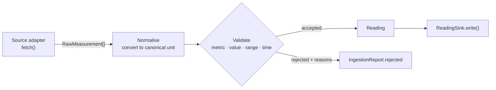

# Data ingestion gateway

HEALium is designed to combine health data from several sources. This document
describes the gateway through which such data enters the system: what exists today,
what is not connected yet, and how to connect a source.

## Status

| Component                                   | Status                                              |
| ------------------------------------------- | --------------------------------------------------- |
| Gateway pipeline (fetch → normalise → validate → store) | Implemented, unit-tested                |
| Metric catalogue and unit conversion        | Implemented, unit-tested                            |
| Simulated source                            | **Connected** (delivers the demo datasets)          |
| File import (CSV / JSON)                    | Parser implemented and tested; no upload dialog yet |
| Wearables, lab analysers, dosimeters, habitat sensors, self-reports, ground uplink | **Not connected** – defined as connection points |
| Storage of readings in the database         | **Not implemented** (in-memory sink only)           |
| Use of readings by the dashboard            | **Not wired** – the UI reads `src/data/simulated` directly |

In short: the connection points exist and the pipeline works end to end with simulated
data, but no real device or external system is attached.

## Where the code is

```
src/ingestion/
├── index.ts                 Public API (createGateway)
├── core/
│   ├── types.ts             RawMeasurement, Reading, DataSourceAdapter, IngestionReport
│   ├── metrics.ts           Catalogue of known metrics, canonical units, plausible ranges
│   ├── units.ts             Unit conversion
│   ├── validation.ts        Turns a raw measurement into a validated reading
│   ├── gateway.ts           IngestionGateway: source registry + pipeline
│   └── errors.ts            SourceNotConnectedError, UnknownSourceError
├── sources/
│   ├── registry.ts          List of all sources
│   ├── simulated-source.ts  Connected: demo data
│   ├── *-source.ts          One file per planned source (not connected)
│   ├── file-import-source.ts  CSV / JSON parser
│   └── unconnected-source.ts  Helper for sources without a connection
├── sinks/
│   └── reading-sink.ts      ReadingSink interface, in-memory implementation
└── ingestion.test.ts        Unit tests (npm test)
```

## How data flows



1. **Fetch.** The adapter of a source returns `RawMeasurement`s: metric name, value,
   the unit the source uses, measurement time, and the crew member or location.
2. **Normalise.** The value is converted to the canonical unit of its metric
   (for example °F → °C, psi → kPa, mmol/L → mg/dL).
3. **Validate.** A measurement is accepted only if the metric is known, the value is
   a finite number inside the plausible range of the metric, and the timestamp is
   valid and not in the future. Rejected measurements are returned with the reasons;
   nothing is silently corrected.
4. **Store.** Accepted `Reading`s go to the sink. Each reading has a deterministic id
   (source, metric, subject, time), so ingesting the same data twice creates no
   duplicates.

Every reading carries its origin (`source.id`, `source.kind`) and a quality label:
`measured`, `self-reported` or `simulated`. A simulated value can therefore never be
mistaken for a measurement further down the line.

## Sources

| Id                      | Stands for                                         | Expected transport                                  | Status        |
| ----------------------- | -------------------------------------------------- | --------------------------------------------------- | ------------- |
| `simulated`             | Demo datasets of the prototype                     | In-process                                          | Connected     |
| `wearable-biosensor`    | Body-worn sensors: heart rate, SpO₂, sleep, activity | Bluetooth LE to a base station or vendor API      | Not connected |
| `lab-analyzer`          | On-board blood and urine analysers                 | Device result export (serial / USB / HL7 or FHIR)   | Not connected |
| `radiation-dosimeter`   | Active personal and area dosimeters                | Detector data interface or vehicle data bus         | Not connected |
| `habitat-environment`   | Life-support sensors: CO₂, pressure, temperature, humidity, noise, light | Habitat telemetry stream     | Not connected |
| `crew-self-report`      | Daily check-in answers                             | Internal (backend collection `daily-health-checkins`) | Not connected |
| `ground-medical-uplink` | Results sent by the ground medical team            | Mission communication link (delay-tolerant)         | Not connected |
| `file-import`           | Manual CSV / JSON import                           | File selected by the user                           | Parser ready, no UI |

A source that is not connected is described and registered, but its `fetch()` throws
`SourceNotConnectedError`. The gateway never invents data for it.

## Connecting a source

Each planned source has a file in `src/ingestion/sources/` whose header comment
describes what the adapter has to do. The steps are always the same:

1. **Implement `fetch()`.** Replace `defineUnconnectedSource(...)` with an object that
   implements `DataSourceAdapter`:

   ```ts
   export const wearableBiosensorSource: DataSourceAdapter = {
     descriptor: { id: 'wearable-biosensor', /* … */ status: 'connected', quality: 'measured' },
     async fetch(request) {
       const samples = await readFromDevice(request?.since)   // device-specific
       return samples.map((sample) => ({
         metric: 'heart-rate',
         value: sample.bpm,
         unit: 'bpm',
         recordedAt: sample.timestamp,
         subject: sample.astronautCode,
       }))
     },
   }
   ```

   Report values in the unit the device uses. Conversion is the gateway's job.
2. **Add missing metrics** to `core/metrics.ts` (canonical unit and plausible range)
   and missing unit conversions to `core/units.ts`.
3. **Register** the adapter in `sources/registry.ts` (the planned sources are already
   listed there).
4. **Test** it in `ingestion.test.ts` with recorded sample data.

No other part of the system has to change.

## Using the gateway

```ts
import { createGateway, InMemoryReadingSink } from './ingestion'

const sink = new InMemoryReadingSink()
const gateway = createGateway({ sink })

gateway.listSources()                 // all sources with their connection status
await gateway.ingestAllConnected()    // today: the simulated source
sink.latest('heart-rate', 'MC-01')    // { value: 62, unit: 'bpm', quality: 'simulated', … }
```

## File import format

JSON – an array of measurements:

```json
[
  { "metric": "heart-rate", "value": 62, "unit": "bpm", "recordedAt": "2026-11-15T10:00:00Z", "subject": "MC-01" }
]
```

CSV – header row, one measurement per row (`subject` and `location` are optional):

```csv
metric,value,unit,recordedAt,subject,location
heart-rate,64,bpm,2026-11-15T08:00:00Z,MC-01,
cabin-pressure,14.7,psi,2026-11-15T08:00:00Z,,Habitat module
```

The CSV parser is intentionally simple: values must not contain commas or quotes.

## Remaining steps to production use

These steps are **not done** and are listed here so the gap is explicit:

1. **Persist readings.** Add a `health-readings` collection to the backend and a
   `ReadingSink` that writes to it, with the same owner-only access rules as the
   other private collections.
2. **Read from readings.** Let the feature pages obtain their values from stored
   readings instead of `src/data/simulated` (one feature at a time; the simulated
   source keeps the demo working in the meantime).
3. **Run ingestion on the server.** Trigger `ingestAllConnected()` on a schedule or
   on incoming data, and show per-source status on the Data Sources page.
4. **Add an upload dialog** for the file import.
5. **Connect the first real source** by implementing its adapter as described above.
